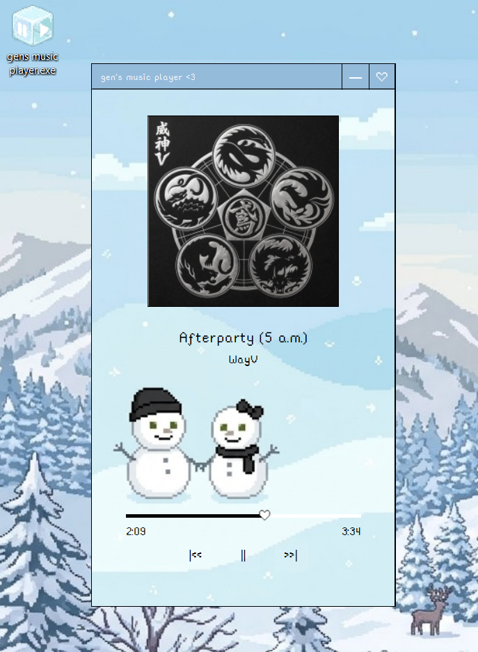

# gen's music player <3

A minimalist, retro-inspired desktop music player built with **Python**, **PyQt6**, and the **Spotify Web API**.

Featuring a custom interface, a heart-shaped progress slider, and Spotify playback controls.

## ✦ Features

### Spotify Integration

- Spotify Web API integration
- OAuth 2.0 authentication with PKCE
- Automatic detection of the connected Spotify desktop device
- Real-time playback state synchronization

### Playback Controls

- Play / pause
- Previous / next track
- Seek through the current track
- Real-time playback progress
- Current and total track duration

### Track Information

- Dynamic song title and artist information
- Album artwork fetched from Spotify

### Custom UI

- Compact 350 × 625 desktop interface
- Frameless window with a custom title bar
- Custom minimize and close buttons
- Custom background and typography
- Heart-shaped progress slider
- Custom application icon
- Retro-inspired minimalist design

### Packaging

- Windows executable support
- PyInstaller packaging
- Bundled fonts and visual assets
- Resource path handling for packaged and development environments

## ✦ Tech Stack

- **Python 3**
- **PyQt6**
- **Spotify Web API**
- **Requests**
- **python-dotenv**
- **PyInstaller**

## Preview



## ✦ Requirements

- Windows
- Python 3
- A Spotify account
- Spotify Desktop application
- A Spotify Developer application

## ✦ Setup

### 1. Clone the repository

```bash
git clone https://github.com/za123456789/gens-music-player.git
cd gens-music-player
```

### 2. Install dependencies

```bash
python -m pip install -r requirements.txt
```

### 3. Configure Spotify authentication

Create an application in the [Spotify Developer Dashboard](https://developer.spotify.com/dashboard).

Add the following redirect URI to your Spotify application's settings:

```text
http://127.0.0.1:8080
```

Create a `.env` file in the project root and add your Spotify Client ID:

```env
SPOTIFY_CLIENT_ID=YOUR_SPOTIFY_CLIENT_ID
```

The application loads this value from the environment using `python-dotenv`. Keep your `.env` file private and never commit it to Git.

The application uses **OAuth 2.0 with PKCE** for authentication.

### 4. Run the application

```bash
python main.py
```

Make sure Spotify Desktop is available and playback is supported by your account and device.

## ✦ Build the Windows Executable

Install PyInstaller:

```bash
python -m pip install pyinstaller
```

Build the executable in PowerShell:

```powershell
python -m PyInstaller --clean --onefile --windowed --name="gens_music_player" --icon="app icon.ico" --add-data="rainyhearts;rainyhearts" --add-data="assets;assets" main.py
```

The executable will be generated inside the `dist` directory.

Configure `SPOTIFY_CLIENT_ID` in the environment used to launch the executable. A `.env` file can also be placed next to the executable if the application is configured to load it from that location.

## ✦ Project Structure

```text
gens-music-player/
├── assets/
├── rainyhearts/
├── main.py
├── app icon.ico
├── requirements.txt
├── .gitignore
└── README.md
```

## ✦ Notes

- A Spotify Client ID must be configured before running the application.
- The application uses Spotify's Web API to retrieve playback information and control playback.
- Playback functionality depends on Spotify account eligibility, device availability, and API access.
- No Spotify Client Secret is required by this PKCE-based implementation.

This project was created as a personal project to explore desktop GUI development, API integration, OAuth authentication, and application packaging.

---

Made with Python ♡
